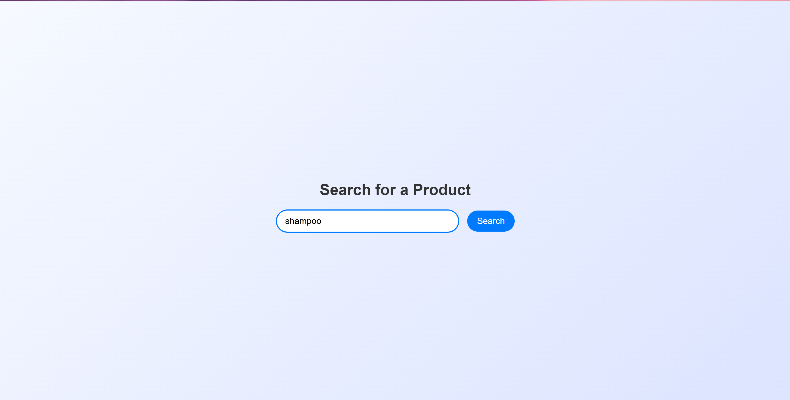
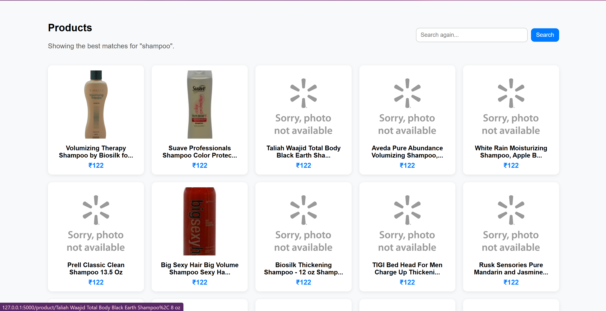
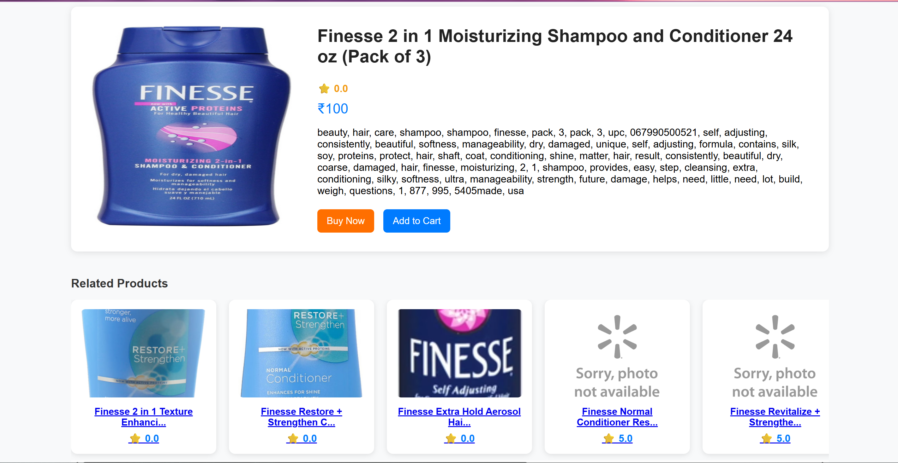

# Product Recommendation System

A machine-learning-based product search and content-based recommendation system built with Python and Flask. The system uses TF-IDF and cosine similarity to find relevant products and recommend similar products based on product attributes and descriptions.

## What the project does

The project has two related ML features:

1. **Product search**
   - User enters a keyword such as `shampoo`, `lipstick`, or `razor`.
   - TF-IDF converts the query and product information into vectors.
   - Cosine similarity ranks products by relevance.

2. **Content-based recommendations**
   - When a user opens a product, the system compares its product tags with all other products.
   - Products with the most similar TF-IDF vectors are shown as related products.

## Project structure

```text
product-recommendation-system/
├── app.py                         # Flask application + search/recommendation logic
├── build_data.py                  # Builds models/clean_data.csv from the TSV
├── text_repair.py                 # Repairs garbled characters (used by build_data.py and app.py)
├── Recommendation_System.ipynb    # Original ML training/preprocessing notebook
├── requirements.txt               # Packages needed to build the data and run the app
├── requirements-dev.txt           # requirements.txt plus the test tools (pytest)
├── tests/                         # pytest tests
├── .gitignore
├── screenshots/
│   ├── Screenshot_Home.png        
│   ├── Screenshot_Product.png  
│   └── Screenshot_Recommendation.png  
├── models/
│   ├── clean_data.csv             # Processed product dataset (generated by build_data.py, not committed)
│   └── trending_products.csv      # Top-rated products used on the home page
├── templates/
│   ├── index.html                 # Search page
│   ├── main.html                  # Search results
│   └── product.html               # Product details + recommendations
└── static/
    ├── style.css
    └── img/                       # Fallback product images
```

## ML pipeline

```text
Raw Walmart TSV
      |
      v
Select useful columns
      |
      v
Fill missing values + rename columns
      |
      v
Clean Category / Brand / Description with spaCy
      |
      v
Create Tags
      |
      +------------------------+
      |                        |
      v                        v
Rating-based ranking      TF-IDF text representation
      |                        |
      v                        v
trending_products.csv    Cosine similarity
                               |
                               v
                       Related products
```

## 🔎 ML-Powered Product Search

The system provides relevance-based product search using **TF-IDF vectorization and cosine similarity**.

Instead of relying only on exact product-name matching, each product is represented using a combined text representation containing:

- Product name
- Category
- Brand
- Processed product tags

The user's search query is transformed into a TF-IDF vector and compared against the product representations using cosine similarity. Products are then ranked by relevance and the most relevant results are returned.

```text
User Query
    ↓
TF-IDF Vectorization
    ↓
Cosine Similarity
    ↓
Relevance Ranking
    ↓
Top Matching Products
```

## 🖥️ Preview

<p align="center">
  
  
  
</p>

`SearchText` combines:

- product name
- category
- brand
- processed tags

## Run locally

```bash
python -m venv venv
```

Windows:

```bash
venv\Scripts\activate
```

macOS / Linux:

```bash
source venv/bin/activate
```

Install the app's dependencies:

```bash
pip install -r requirements.txt
```

Build the processed dataset (reads the Walmart TSV in this folder, writes `models/clean_data.csv`, takes a few seconds):

```bash
python build_data.py
```

Run:

```bash
python app.py
```

Then open:

```text
http://127.0.0.1:5000
```

## Tests

The test tools are kept out of the app's requirements. To run the tests, install the development requirements instead (they include everything in `requirements.txt`):

```bash
pip install -r requirements-dev.txt
```

Then, from the project folder:

```bash
pytest
```

The tests build the data from the TSV themselves (into a temporary folder), so they do not need `python build_data.py` to have been run first and do not touch `models/clean_data.csv`. They cover the build (including the spaCy tags, checked against the outputs saved in the notebook), prices, descriptions, images, ratings, search and related products.

## Notes

- The product page shows the product's description from the dataset's `Product Description` column, cleaned for reading by `build_data.py`: mis-encoded characters are repaired (with `ftfy`), broken `&quot` entities become quotes, website tracking scripts and placeholder values are removed, and whitespace is tidied. Products with no description show "No description available for this product." The processed tags are still what search and related products use.
- Product names: 79 names in the dataset contain `&quot` without its `;` (e.g. `12&quot`, `&quotLiv&quotin`). The app shows them with real quotes, and links, search and the recommendation form use the cleaned names. Four names garbled by an encoding mix-up (e.g. `SuperStay 24 Liquid Lipstick`) are repaired the same way as descriptions, so they read e.g. `SuperStay 24 Liquid Lipstick`. Old links that still contain `&quot` or the garbled characters keep working. Other `&` text (e.g. `P&G`) and names with real accents or symbols are unchanged.
- Ratings come from the dataset's `Product Rating` column (1-5). Products without one (a little over half) show "No ratings yet" instead of a score. Internally those are stored as 0, as in the notebook, so search ranking is unchanged.
- Prices come from the dataset's `Product Price` column and are shown in US dollars. Products with no price in the data show "Price unavailable". Where the same product name appears on several rows with different prices, the first row's price is used everywhere.
- Product images use the first URL from the dataset's image field, which often lists several URLs separated by ` | `. Each product also has a local placeholder from `static/img/`, chosen from its name so it is always the same one; it is shown if the product has no usable URL or the image fails to load in the browser.
- `build_data.py` reproduces the notebook's preprocessing and spaCy tagging. The notebook loaded `en_core_web_sm`, but its tag function only uses token text, which comes from spaCy's English tokenizer alone, so the build uses `spacy.blank("en")` and no model download is needed. The Flask app itself does not need spaCy at runtime.
